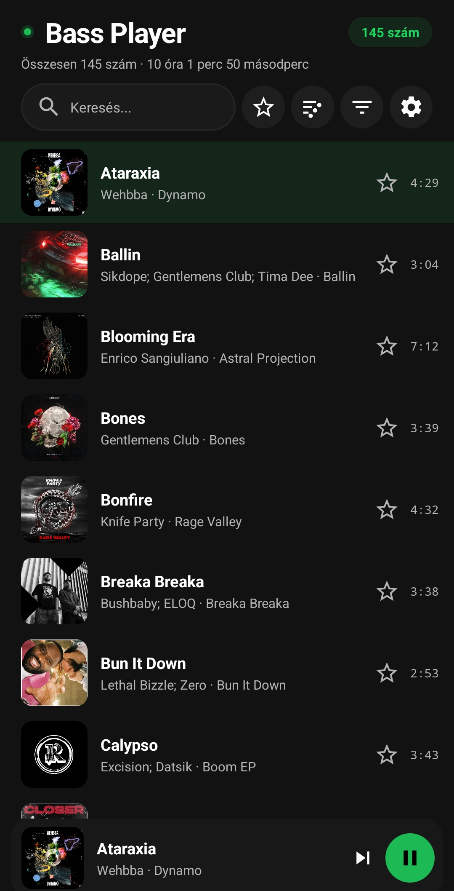
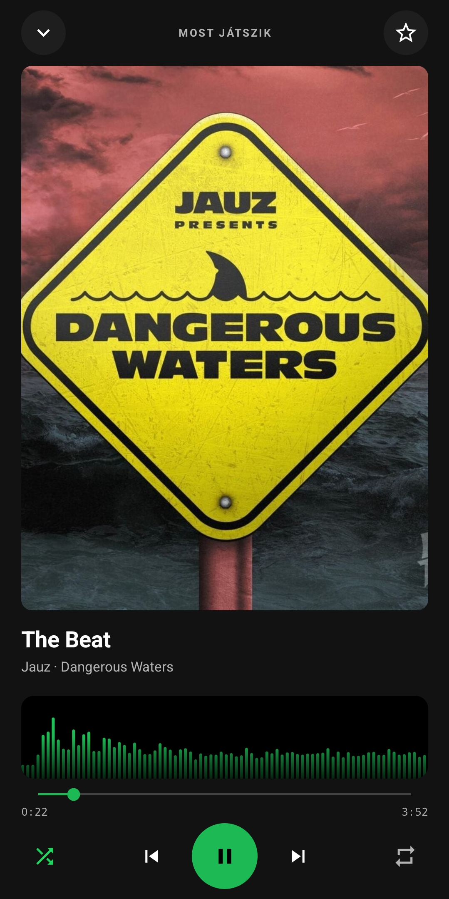
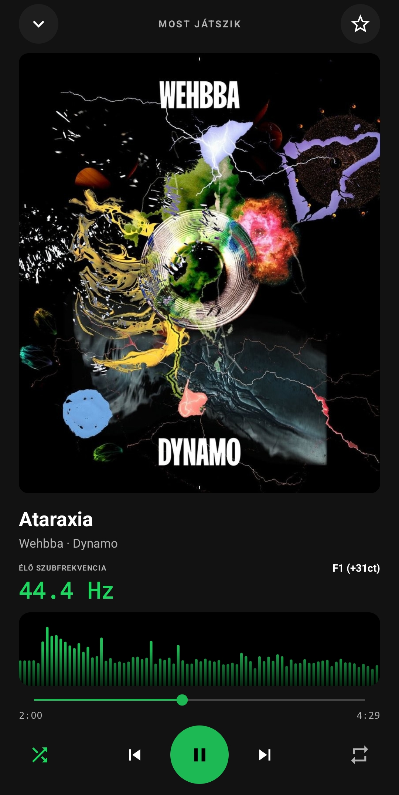

<div align="center">

# BassPlayer

### A lightweight, offline-first Android music player with a live bass-frequency meter.

**100% free · Open source · No ads · No telemetry · No BS**

[Download the latest APK](https://github.com/robot2006/BassPlayer/releases/latest) · [Magyar leírás](#magyar)

</div>

<p align="center">
  
  
  
</p>

## English

BassPlayer plays music stored on your Android device. It works offline and has no advertising, analytics, or telemetry. The release APK is about **4.6 MB**.

### Features

- Browse and search your local music library.
- Filter by artist, including tracks with multiple artists.
- Sort by title, artist, album, date added, or duration.
- Favorites, shuffle, repeat, seeking, and background playback controls.
- Live spectrum visualizer and optional bass-frequency meter.
- Hungarian and English interface. The initial language follows the device language and your choice is remembered.
- No microphone permission and no network permission.

### Install

1. Download `BassPlayer.apk` from [Releases](https://github.com/robot2006/BassPlayer/releases/latest).
2. Open it on an Android device and allow installation from your browser or file manager if Android asks.
3. Grant access to audio files so BassPlayer can list music stored on the device. Notification permission is only used for playback notifications where Android requires it.

Requires Android 8.0 (API 26) or newer. The app does not stream or download music.

### Build from source

Requirements: JDK 17 or newer and Android SDK platform 35.

```bash
./gradlew assembleDebug
```

On Windows, use `gradlew.bat assembleDebug`. A release build from a checkout is unsigned unless you provide your own private signing key. **Never commit a keystore or signing properties file.**

### Privacy

BassPlayer has no `INTERNET` permission. Your library stays on your device. The app reads local audio metadata and audio files for playback, and stores favorites and preferences locally.

### License

BassPlayer is licensed under the [MIT License](LICENSE).

---

<a id="magyar"></a>

## Magyar

A BassPlayer a telefonodon tárolt zenéket játssza le. Offline működik, nincs benne reklám, analitika vagy telemetria. A release APK mérete körülbelül **4,6 MB**.

### Funkciók

- Helyi zenék böngészése és keresése.
- Szűrés előadóra; a közös előadós számok mindegyik érintett előadónál megjelennek.
- Rendezés cím, előadó, album, hozzáadás dátuma vagy hossz szerint.
- Kedvencek, keverés, ismétlés, tekerés és háttérlejátszási vezérlők.
- Élő spektrumvizualizátor és külön ki-/bekapcsolható szubfrekvencia-mérő.
- Magyar és angol kezelőfelület. Első indításkor a telefon nyelvét követi, a választást pedig megjegyzi.
- Nem kér mikrofonengedélyt és nincs hálózati engedélye.

### Telepítés

1. Töltsd le a `BassPlayer.apk` fájlt a [Releases](https://github.com/robot2006/BassPlayer/releases/latest) oldalról.
2. Nyisd meg Androidon, és ha a rendszer kéri, engedélyezd a telepítést a böngésző vagy fájlkezelő számára.
3. Engedélyezd a hangfájlok elérését, hogy az app listázni tudja a készüléken tárolt zenéket. Az értesítési engedély csak a lejátszási értesítésekhez kell azokon az Android-verziókon, ahol ezt a rendszer megköveteli.

Android 8.0 (API 26) vagy újabb rendszer szükséges. Az alkalmazás nem streamel és nem tölt le zenéket.

### Fordítás forráskódból

Szükséges: JDK 17 vagy újabb és Android SDK 35.

```bash
./gradlew assembleDebug
```

Windows alatt: `gradlew.bat assembleDebug`. A forrásból készített release build saját aláírókulcs nélkül aláíratlan. **Aláírókulcsot és jelszavas properties fájlt soha ne tölts fel a repóba.**

### Adatvédelem

A BassPlayer nem kap `INTERNET` engedélyt. A zenetárad a készüléken marad. Az app a helyi hangfájlok metaadatait és tartalmát olvassa lejátszáshoz; a kedvenceket és beállításokat helyben tárolja.

### Licenc

A BassPlayer az [MIT License](LICENSE) feltételei szerint használható.
